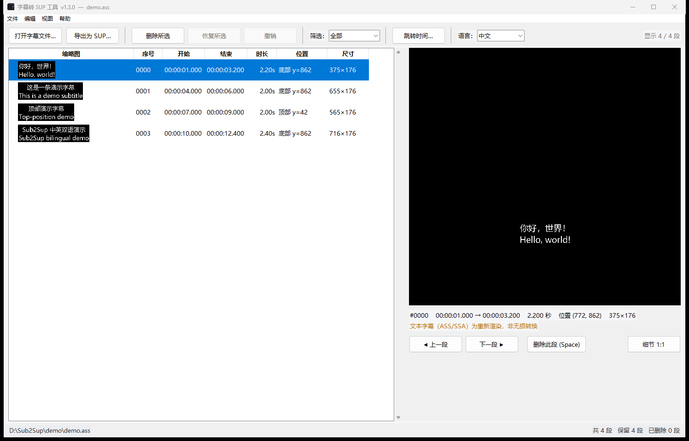

# Sub2Sup — 图形字幕转 SUP 工具

把 VobSub 图形字幕（`.idx + .sub` 配套，或单个 `.sub`）**无损**转换为蓝光 PGS 字幕（`.sup`），
也支持把 **ASS / SSA / SRT / WebVTT / MicroDVD** 文本字幕重新渲染为 PGS；
并支持在转换前**逐段预览、删除**不需要的字幕，例如字幕组信息、片头/片尾水印等。

Windows 图形界面（中文 / English 可切换），单文件 exe，不需要安装 Python。当前版本 **v1.3.0**。支持 VobSub、ASS/SSA/SRT/VTT/MicroDVD 文本字幕，以及 PGS `.sup` 输入；可选 VSFilter 高级渲染。
支持 Blu-ray 1080p SDR 与 UHD HDR 输出配置（1080p PGS + HDR 亮度预设，可选试验性 4K PGS）。
支持把字幕文件直接拖进程序窗口，或拖到 exe 图标上打开。
支持自动检查更新，发现新版本可直接下载并在退出后替换重启。

## 界面截图

中文界面：


English UI:


文本字幕（ASS）预览：



界面语言可在「视图 → 语言」或工具栏右上角的「语言 / Language」下拉框中随时切换；
首次启动跟随系统语言，之后会记住选择。

## 下载

到 [Releases](https://github.com/694185819/sub2sup/releases) 下载 `Sub2Sup.exe`，双击即可运行。
也可直接把 `.idx` / `.ass` / `.srt` 等字幕文件拖到 exe 上打开。

> 从源码构建：见下方「从源码构建」。

## 功能

- 读取 VobSub `.idx / .sub`（自动查找同名 `.sub`），也支持单独一个 `.sub`
- 读取 **ASS / SSA / SRT / WebVTT / MicroDVD**，重新渲染为 PGS
- 读取 PGS `.sup`，按段预览/删除/重新导出
- 可选 **VSFilter 高级渲染**：调用本机 easyavs2bdnxml + VSFilterMod + AviSynth，
  处理 `\p` 绘图、动画、旋转、卡拉OK等复杂 ASS
- 列表 + 预览：缩略图、开始/结束时间、位置（顶部/中部/底部/整屏）、尺寸
- 大图预览：显示字幕在 1920×1080 画面中的实际位置；「细节 1:1」可放大
- 多选删除 / 恢复 / 撤销 / 全部恢复；按「仅顶部、仅整屏、已删除」等筛选
- 导出标准 Blu-ray PGS `.sup`：VobSub 保留原始位图/时间轴/alpha；
  文本字幕按系统字体重新排版渲染
- 导出后自动结构自检；可直接交给 tsMuxeR / mkvmerge 封装
- 支持多语言轨 `.idx`；中文 / English 界面可实时切换
- **UHD HDR 输出**：1080p PGS + HDR 字幕亮度预设（144 灰 / 自定义），
  可选试验性 4K PGS（文本字幕为 4K 原生重绘）
- **拖拽打开**：把字幕文件拖进窗口，或拖到 exe 图标上
- **自动更新**：启动时静默检查 GitHub Release（每 24 小时最多一次），
  发现新版本可在程序内查看说明、下载并安装/重启

## 使用

1. 双击 `Sub2Sup.exe`（或把字幕文件拖到 exe 上，或拖进已打开的窗口）。
2. 「打开字幕文件…」选择 `.idx`（自动找同名 `.sub`）、VobSub `.sub`、
   `.ass / .ssa / .srt / .vtt`、MicroDVD `.sub` 或 PGS `.sup`。
3. 在左侧列表浏览段落；找字幕组信息时，可把「筛选」设为「仅顶部」或「仅整屏」。
4. 选中要删除的段（可多选），点「删除所选」（或按空格/Delete/双击）。
   删除只是标记，随时可「恢复」或「撤销」，不会改动原文件。
5. 「导出为 SUP…」，确认输出路径、画布尺寸、帧率后导出。
6. 用 tsMuxeR 添加字幕轨（语言 `chi`）封装回原盘 ISO；mkvmerge 也可直接封装。

快捷键：`Ctrl+O` 打开、`Ctrl+E` 导出、`Ctrl+Z` 撤销、`Ctrl+G` 跳转时间、
`Space` 删除/恢复当前段、`PgUp/PgDn` 上下翻 10 段。

## 演示字幕

`demo/demo.idx` + `demo/demo.sub` 是程序生成的纯演示字幕（4 段中英双语文字，无版权内容），
打开即可试用本工具；`demo/demo.ass`、`demo/demo.srt` 与 VSFilter 生成的
`demo/demo.sup` 是同一内容的文本/PGS 演示。上面的界面截图也来自这份演示字幕。

## 为什么是“无损”

- **位图**：按原 2-bit 调色板索引 1:1 重编码为 PGS RLE，不重新渲染、不缩放；
  每个像素都与源 SPU 一致。
- **时间轴**：起止时间沿用原 90 kHz 时间戳（与 `.idx` 一致），不做取整或重采样。
- **alpha**：源 SPU 的 4-bit alpha（0–15）精确映射为 PGS 的 0–255。
- **颜色**：调色板 RGB 转成 PGS 规定的 YCbCr（BT.709 / BT.601 limited range），
  经解码后与源 RGB 的误差 ≤1/255（YCbCr 量化本身不可避免的 1 级误差）。

## 文本字幕（ASS / SSA / SRT / VTT / MicroDVD）

文本字幕没有位图，工具会按系统字体**重新排版渲染**成 PGS；这一路径不是无损转换，
但同样支持预览、按段删除、时间轴、UHD/HDR 与 4K。

- ASS 常用样式：字体、字号、粗体/斜体/下划线/删除线、主色/描边色/阴影色、
  描边宽度、阴影、对齐、边距、字距 Spacing / `\fsp`、`\pos` / `\an`、`\N` 换行、
  `\h` 空格、矩形 `\clip` / `\iclip`、`\blur` / `\be` 边缘模糊、内联颜色等。
- SRT / VTT / MicroDVD 长行按画面宽度自动换行（中文按字、英文按单词）。
- SRT / VTT：基础 `<b> <i> <u> <font color>`、`{\an8}`、VTT `align/line` 设置。
- MicroDVD：自动读取帧率头，基础 `{Y:i}` 等样式；默认 23.976 fps。
- 重叠字幕按时间区间合成到同一画面，逐段删除仍然有效。
- 不支持 `\p` 绘图、`\move` / `\t` 动画、旋转、卡拉OK变色等复杂特效；
  遇到会提示并忽略，不会中断导出。
- 字体来自 Windows 系统，找不到时回退到微软雅黑 / 黑体 / Arial。
- 4K PGS 时文本按 3840×2160 原生重绘，比放大 1080p 位图更清晰。

## SUP 输入与 VSFilter 高级渲染

- `.sup`（PGS）可直接打开/拖入，逐段预览、删除、重新导出。
- 内置渲染器不支持 `\p` 绘图、`\move` / `\t` 动画、旋转、卡拉OK变色等复杂特效。
- 如果装有 **AviSynth + VSFilterMod + avs2bdnxml**：
  1. 菜单「文件 → ASS 高级渲染（VSFilter）…」
  2. 指定 `avs2bdnxml.exe` 与 `VSFilterMod.dll`（可自动检测，路径会记住）
  3. 渲染为 1920×1080 SUP，完成后自动载入，可继续编辑/导出
- 高级渲染依赖外部组件，不是纯单文件；输出 1080p，动画会拆成较多段，渲染较慢。

## UHD / HDR（4K 原盘）

UHD 原盘的实际做法通常是 **1920×1080 PGS 由播放器放大到 4K**；推荐：

- 目标规格选 `UHD HDR`：保持 1920×1080，不缩放位图/坐标
- 帧率与视频一致：23.976 / 24 / 25 / 50 / 59.94 / 60（UHD 模式会限制这些值）
- HDR 字幕亮度：建议 **144 灰（Y≈140）**。HDR 下 SDR 的白会偏亮；程序提供
  235 / 140 / 153 / 171 / 自定义 Y 预设，只压缩亮度、不改色相
- `4K PGS`（3840×2160）为试验性输出：VobSub 位图按 2× nearest 放大，
  文本字幕按 4K 原生重绘；部分播放器/封装工具可能不接受，需实测
- PGS 本身不带 HDR 元数据，调色板始终是 SDR BT.709 limited；HDR10 的
  MaxCLL / MaxFALL / Mastering display 信息在视频里，封装时保持视频流直通即可

自测：UHD 输出 20 段 / 4K 输出 8 段逐像素比对通过（PCS 1920×1080 / 3840×2160、
峰值调色板 Y≤140、无对象越界、时间戳不变）。

## 自动检查更新

- 启动后最多每 24 小时静默检查一次 GitHub Release；发现新版本时工具栏右侧出现
  「发现新版本 vX，点击更新」，也可用「帮助 → 检查更新…」手动检查。
- 更新窗口显示当前/最新版本与更新说明，可打开 Release 页面，或直接下载并安装。
- 下载会校验文件大小；GitHub API 提供 SHA256 时会一并校验。
- exe 版下载完成后可「立即安装并重启」：程序退出后由辅助进程替换并启动新版；
  源码运行时只下载并打开所在文件夹。
- 网络只访问 GitHub；API 限流时自动回退到 `releases/latest` 页面重定向。

## 输出规格

- 容器：`.sup`（`PG` 头 + PTS/DTS，90 kHz，big-endian + PGS 段）
- 显示集：PCS / WDS / PDS / ODS / END；每段结束写入清屏显示集
- 每个字幕一个 epoch（composition_state = epoch start），对象 0、窗口 0
- 调色板：VobSub 通常 5 个条目（索引 0 透明 + 像素值 0..3 对应索引 1..4）；
  文本字幕最多 255 个条目（抗锯齿/颜色）
- 帧率代码：UHD 模式 23.976 / 24 / 25 / 50 / 59.94 / 60；BD 模式另含 29.97 / 30
- 大对象（RLE > 60 KB）自动分片为 ODS 序列，通过解码校验

## 从源码构建

需要 Windows + Python 3.11+。

```bat
py -3 -m pip install pyinstaller tkinterdnd2 pillow
build.bat
```

生成 `dist\Sub2Sup.exe`。exe 已打包 Tk、tkinterdnd2 与 Pillow，运行时不需要安装 Python。
VSFilter 高级渲染为可选功能，需要用户另行安装 AviSynth 并提供 VSFilterMod/avs2bdnxml。

## 命令行（可选）

```bat
set PYTHONPATH=src
py -3 -m sub2sup --cli "影片.idx" --list
py -3 -m sub2sup --cli "影片.idx" --out "影片.sup" --drop 0,1088 --verify
py -3 -m sub2sup --cli "影片.idx" --out "影片.sup" --keep 10-20
py -3 -m sub2sup --cli "字幕.sub" --out "字幕.sup" --canvas 1920x1080
py -3 -m sub2sup --cli "影片.idx" --out "影片-uhd.sup" --profile uhd --hdr-target 140
py -3 -m sub2sup --cli "影片.idx" --out "影片-4k.sup" --profile 4k --limit 20
py -3 -m sub2sup --cli "字幕.ass" --out "字幕.sup" --verify
py -3 -m sub2sup --cli "字幕.srt" --out "字幕-4k.sup" --profile 4k --limit 5
py -3 -m sub2sup --cli "字幕.ass" --vsrender --out "字幕.vs.sup"
py -3 -m sub2sup --cli "字幕.sup" --list
```

参数：`--drop 0,5,10-12` 删除指定段；`--keep` 只保留指定段；`--fps`；`--offset-ms`；
`--profile bluray|uhd|4k`；`--hdr-target 16..235`（UHD 默认 140）；
`--dump 目录` 输出每段预览 PNG；`--verify` 自检。

自检脚本（转换后逐段比对位图/位置/时间/颜色）：

```bat
py -3 tests\selftest.py "影片.idx"
py -3 tests\selftest.py demo\demo.idx
py -3 tests\text_selftest.py
py -3 tests\sup_selftest.py
```

## 已知限制

- 单独 VobSub `.sub` 不含调色板：使用经典默认 16 色，画布尺寸需在导出时确认；
  有对应的 `.idx` 时请直接打开 `.idx`。
- 极少数 DVD SPU 在一个包内含多帧动画，转换时只保留第一帧（载入时会提示）。
- `.idx` 中的 `custom colors`、`scale`、`org` 等非常规字段不支持，载入时会提示。
- 输出为 PGS 图形字幕，不可在播放器中修改字体/字号。
- 文本字幕是重新渲染：ASS 绘图、动画、旋转、卡拉OK变色、复杂字体变形等不支持；
  可用「ASS 高级渲染（VSFilter）」处理。SRT 长行会自动换行。
- 高级渲染需要 AviSynth + VSFilterMod + avs2bdnxml，输出 1920×1080 SUP；
  动画/移动会拆成较多段，渲染时间较长，且不是纯单文件模式。
- SUP 输入按每段位图读取；极少数动态调色板更新的 PGS 可能按段静态显示。

## 免责声明

本项目仅用于个人备份、已有合法副本的格式转换与学习交流。
请确保你对所处理的影音内容拥有合法使用权，不要将转换结果用于传播受版权保护的内容。
本仓库**不包含**任何影片、字幕样本或截图。

## 许可证

[MIT](LICENSE)
